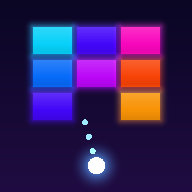

# Blaster Bricks

A relaxed, glowing ball-shooter PWA. Drag to aim, release to fire a stream of balls, clear every brick before one reaches the line.

Levels generate themselves from the level number, how well you cleared the last one, and your running effectiveness average.

- `npm run dev`: play on your phone over LAN
- `npm run build`: typecheck and build
- `npm run bot -- 30`: headless balance check with three bot skill levels
- `npm run icons`: regenerate PNG icons
