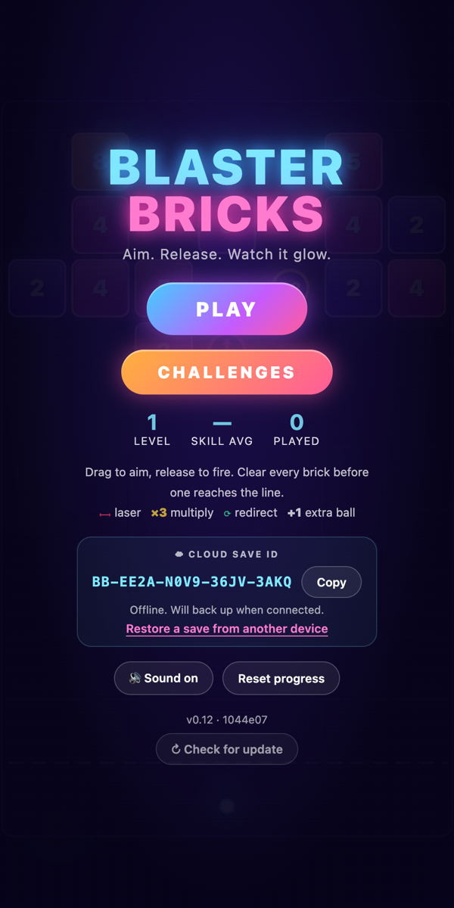
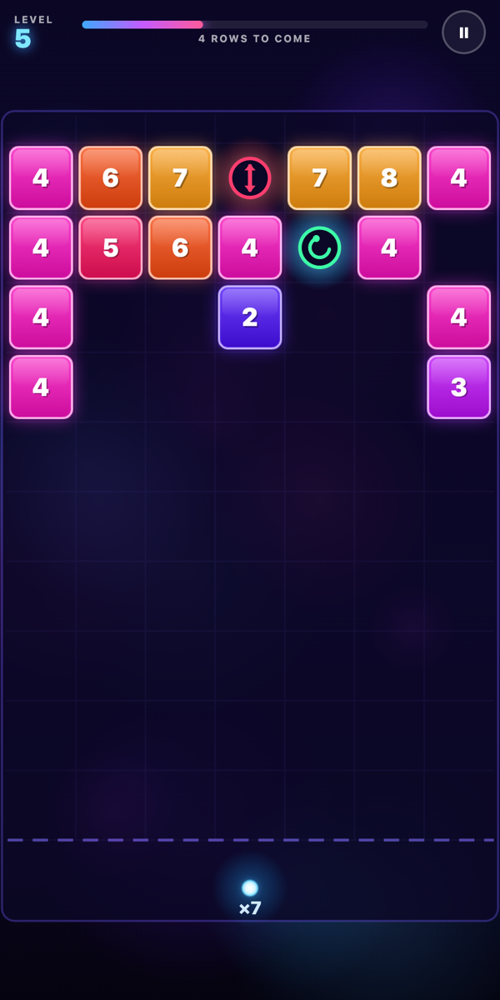
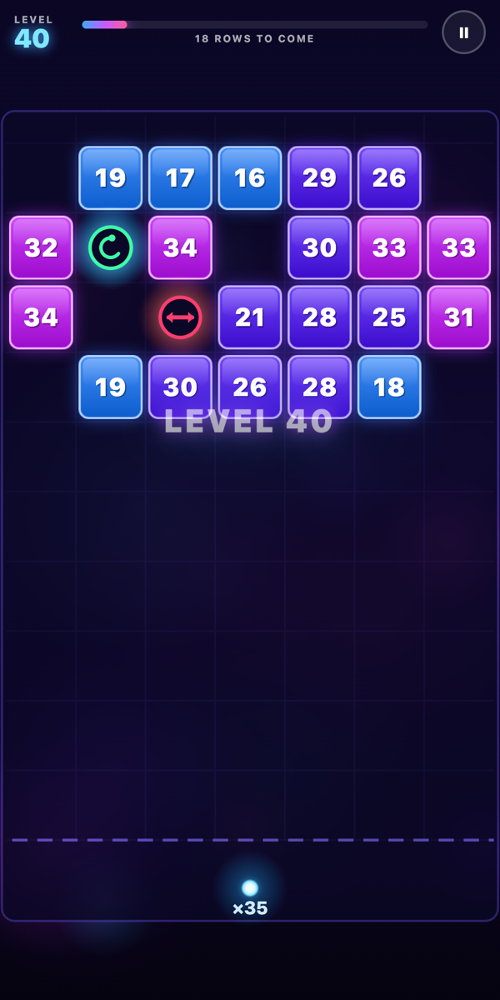

<p align="center">
  
</p>

<h1 align="center">Blaster Bricks</h1>

<p align="center">
  <strong>A relaxed, neon ball-shooter that installs from the browser. No app store, no ads.</strong>
</p>

<p align="center">
  <a href="https://blaster-bricks.vercel.app"><strong>▶ Play it now</strong></a> ·
  <a href="#deploy-your-own">Deploy your own</a> ·
  <a href="#run-it-locally">Run it locally</a>
</p>

<p align="center">
  <a href="https://vercel.com/new/clone?repository-url=https%3A%2F%2Fgithub.com%2FMRhino%2Fblaster-bricks&project-name=blaster-bricks&stores=%5B%7B%22type%22%3A%22blob%22%7D%5D"></a>
</p>

<p align="center">
  
  
  
</p>

---

## At a glance

| | |
|---|---|
| **Genre** | Turn-based ball-shooter / brick breaker |
| **Platform** | Any modern phone or desktop browser. Installs as a PWA, works offline |
| **Stack** | TypeScript, Canvas 2D, Vite, `vite-plugin-pwa`, one Vercel Function for cloud save |
| **Size** | About 2,500 lines of TypeScript. No game engine, no UI framework |
| **Hosting** | Vercel (static site + `api/save.ts`) |

## How it plays

- **Drag to aim, release to fire.** Your whole stack of balls streams out along that line and bounces around the board.
- **Clear every brick** before one reaches the dashed line. The number on a brick is how many hits it needs.
- **Power-ups** sit in the grid: lasers that sweep a row or column, ×3 multipliers, redirects, and +1 extra ball.
- **Levels write themselves.** Each board is generated from the level number, how cleanly you cleared the last one, and your running skill average, so it stays challenging without spiking.

### Challenges

Everyone gets the same board for each period, seeded from the date:

| Challenge | Rotates | Mechanic |
|---|---|---|
| **Daily** | Every day | Crystal Escort, Steel Maze or Colour Clash |
| **Weekly Rush** | Every week | The board keeps falling while you shoot |
| **Monthly Boss** | Every month | One big boss brick guarded by crystals |

Each challenge awards 1–3 stars, keeps a daily streak (with streak freezes), and unlocks cosmetic ball and background styles.

## How it's built

```
src/
  sim.ts         Pure game simulation: seeded RNG, fixed 240 Hz timestep, no DOM
  render.ts      Canvas renderer, glow effects, animations
  main.ts        Input, screens, game flow, PWA update handling
  challenges.ts  Daily / weekly / monthly board generation (same for everyone)
  meta.ts        Stars, streaks, freezes, cosmetic unlocks
  progress.ts    Local save with versioned migrations
  cloud.ts       Cloud backup client (sync on launch and after each level)
  saveid.ts      Save IDs + merge rules shared by client and server
  audio.ts       Synthesised sound effects (Web Audio, no files)
api/
  save.ts        Vercel Function: one private Blob per save ID
scripts/
  bot.ts         Headless bots (casual / decent / sharp) for balance checks
  challenges.ts  Bot calibration for challenge star rates
```

Things worth calling out:

- **The simulation is pure and deterministic.** The same `sim.ts` runs in the browser and in Node, so headless bots can play hundreds of levels to check balance before anything ships (`npm run bot -- 30`).
- **Difficulty is one number.** A single pressure value combines level growth, your skill average and your last result. No stacked multipliers that run away from the player.
- **Progress survives every deploy.** The save format is versioned with migrations, and the service worker never reloads the page mid-level.
- **Cloud save without accounts.** You get a private save ID like `BB-XXXX-XXXX-XXXX-XXXX`. Type it on another device to restore. The server merges saves and never lets one with less progress overwrite one with more.

## Deploy your own

This repo is set up to go live on Vercel with no configuration.

1. Click **Deploy with Vercel** above. It forks the repo to your GitHub account, creates a Vercel project, and offers to create a **Blob store** for cloud saves.
2. Wait for the build (about a minute). Vercel detects Vite automatically: build command `npm run build`, output `dist/`.
3. Open your new URL on a phone and choose **Add to Home Screen** (Safari) or **Install app** (Chrome). It now runs fullscreen and offline like a native app.

Every push to `main` redeploys. Players get the new version automatically the next time they open the app between levels.

**Doing it by hand instead:** fork the repo, import it at [vercel.com/new](https://vercel.com/new), then add a Blob store under **Storage → Create → Blob** and connect it to the project. That sets `BLOB_READ_WRITE_TOKEN` for you.

**Cloud save is optional.** Without a Blob store the game still works fully; progress is kept on the device, and only the cross-device backup is unavailable.

Preview deployments write saves under `preview/saves/`, so testing a branch never touches real player data.

## Run it locally

You need **Node.js 22.12 or newer**.

```bash
git clone https://github.com/MRhino/blaster-bricks.git
cd blaster-bricks
npm install
npm run dev        # http://localhost:5173, also exposed on your LAN to test on a phone
```

| Command | What it does |
|---|---|
| `npm run dev` | Dev server with hot reload |
| `npm run build` | Type-check and build into `dist/` |
| `npm run preview` | Serve the production build |
| `npm test` | Streak, save-merge, migration and mechanic tests |
| `npm run bot -- 30` | Headless balance check with three bot skill levels |
| `npm run challenges` | Calibrate challenge star rates with the bots |
| `npm run icons` | Regenerate the PNG app icons (drawn by a script, no image libraries) |

`dist/` is a plain static site, so it can be hosted anywhere. Cloud save needs the `api/` function, which is why Vercel is the recommended home. Installing to the home screen and offline play need HTTPS, so test those on a deployed build.

**Screenshot mode:** `?shot=LEVEL&ang=RADIANS&freeze=MS` opens a level, fires at that angle and freezes the frame. Useful for docs and visual checks.

## Make it your own

- **Name, colours, description:** the PWA manifest in [`vite.config.ts`](vite.config.ts) and the `<title>` in [`index.html`](index.html).
- **Icons:** edit and run [`scripts/make-icons.mjs`](scripts/make-icons.mjs).
- **Balance:** `pressureFor` in [`src/sim.ts`](src/sim.ts), then check with `npm run bot -- 30`.
- **Save key:** if you fork into a different game, change the `bb-` localStorage keys so saves don't collide with this one on the same domain.

## Built with an AI pair programmer

Built in short loops with [Claude Code](https://claude.com/claude-code): play a build on a phone, give feedback, adjust. The working rules for that loop (version bump on every push, bot-checked balance changes, never lose progress) live in [`CLAUDE.md`](CLAUDE.md).

## More games

- [**Grid Lock**](https://github.com/MRhino/grid-lock): a tin-toy sliding-traffic puzzle with 300 generated levels
- [**Gate Runner**](https://github.com/MRhino/gate-runner): a 3D squad shooter in Three.js

## License

[MIT](LICENSE). Fork it, reskin it, ship it.
